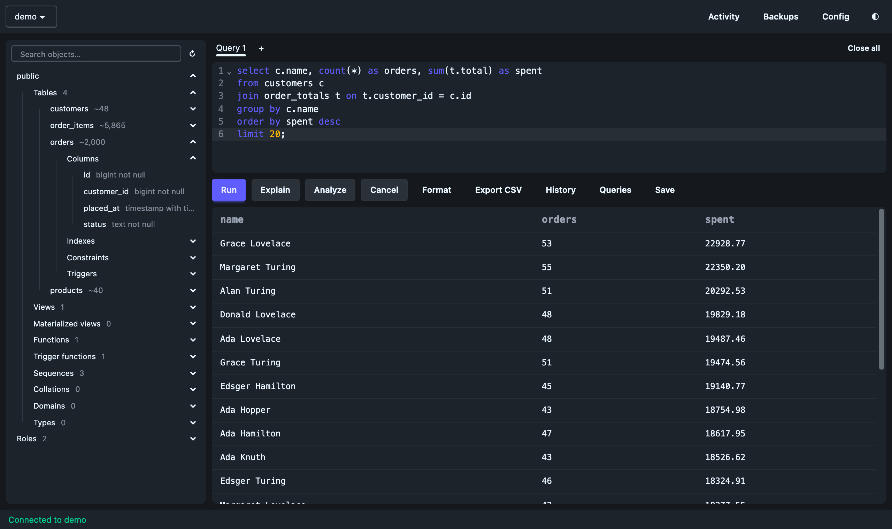

# pg

A personal Postgres IDE: Wails v3 window, templ + HTMX UI, pgx underneath.



Connections come from `~/.pg_service.conf` (or `$PGSERVICEFILE`), passwords from `~/.pgpass`, so the app stores no credentials of its own.

```ini
# ~/.pg_service.conf
[local]
host=localhost
port=5432
dbname=postgres
user=postgres

# ~/.pgpass, as host:port:database:user:password
localhost:5432:*:postgres:password
```

Postgres ignores `.pgpass` unless only you can read it, so run `chmod 600 ~/.pgpass` after making it. pg warns if it's readable by others.

To make a service read-only, for production say, add this line to it. pg shows a badge when it's on. It's a safety net rather than a lock, as `set default_transaction_read_only = off` turns it back off (Postgres 14 or later is needed for the badge).

```ini
options=-c default_transaction_read_only=on
```

## Run

```sh
go run ./cmd/pgide          # the desktop app (needs Xcode command line tools for cgo)
```

To use it like any other app, with its name and icon in the Dock:

```sh
scripts/bundle.sh                 # builds dist/pg.app
cp -R dist/pg.app /Applications
```

It keeps its own tabs, history and settings, separate from `go run`.

## Work on the UI

```sh
templ generate --watch      # in one terminal
go run ./cmd/dev            # in another, then open http://127.0.0.1:8080
tmp/tailwindcss -i web/css/app.css -o web/static/app.css --minify --watch   # when changing classes
```

The templ CLI version should match the `github.com/a-h/templ` version in go.mod.

The SQL editor is CodeMirror 6, bundled from `web/js/app.js` into `web/static/app.js`, which is generated and kept in the repo. Node is only needed to change it:

```sh
npm ci && npm run build && npm test
```

Styling is daisyUI 5.7.46 (vendored as `web/css/daisyui.mjs`) on the Tailwind standalone CLI. `web/static/app.css` is generated, so edit `web/css/app.css` instead. The CLI isn't kept in the repo; on Apple silicon, fetch it once with:

```sh
mkdir -p tmp && curl -fsSLo tmp/tailwindcss https://github.com/tailwindlabs/tailwindcss/releases/download/v4.3.3/tailwindcss-macos-arm64 && chmod +x tmp/tailwindcss
```

## Test

Tests that need a real server name a service from your service file, and are skipped without one. The Docker tests also need Docker, and only use throwaway containers.

```sh
PGIDE_TEST_SERVICE=your-service go test -race ./...
npm test
```

## Using it

- ⌘/Ctrl+Enter runs the selection, or the whole editor if nothing's selected. So do Explain, Analyze and Export CSV.
- Several statements show one result after another, each with its own row count. Later ones load as you scroll to them, as a long first result does. Statements sent together are one transaction, so if one fails, those before it are rolled back even though their results stay on screen.
- `:name` in a query asks for a value before running, offering the last one used. Values go in as quoted text, so `where id = :id` becomes `where id = '42'`, and typing NULL sends a null. They can't stand in for table or column names. History keeps the `:name`.
- Explain and Analyze show the plan as a tree, each step with a bar for its share of the time, or of the cost if it wasn't run. The slowest step's bar is amber, and row estimates out by 10 times or more are flagged. Click a step for its other details, or use Copy JSON for the raw plan. An `explain` typed into the editor still shows as text.
- Autocomplete offers the columns of the tables in the statement under the cursor, wherever it is in the statement.
- Config opens the service and password files in your text editor, creating them if need be. pg never reads them itself beyond connecting, and new services appear when you come back to it.
- Queries lists the `.sql` files in `~/pg-queries` and its subfolders, and picking one opens it in a tab without running it. Save writes the tab there, using the Save dialog in the app, offering the query the tab came from; in a browser, a name like `stats/Sizes` files it in a subfolder. They're plain files, so edit, delete or put them in git as you like. A few starters are added when the folder is first made.
- Backups needs Docker, and runs `pg_dump` from the image matching the server, so nothing has to be installed. Files go in `~/pg-backups`; anything ending `.backup` in there is listed, so older ones can be copied in.
- Open in sandbox restores a backup into a throwaway container, which then appears in the service list. It's a copy of real data, bound to `127.0.0.1`, and stays in Docker until you remove it in Backups.
- Verify proves a backup restores: every table it lists has to arrive, in a throwaway container that's then removed. Connected to the same database, it also compares row counts, which runs `count(*)` on every table there.
- Restore creates a new database on the connected server. It never touches an existing one, and removes the new one if anything goes wrong. Owners and grants are left out, so everything belongs to the connected user.
- Replace swaps the connected database for a backup, after you type its name. The backup is restored beside it and checked first, keeping owners and grants, so a bad one changes nothing. Then two renames swap them in moments, disconnecting anyone using it, and the previous database stays as `<name>_old_<date>` until you drop it. To undo, rename them back.
- Click a result cell to read all of it, format JSON and copy it.
- Export CSV asks where to save in the app, and saves to `~/Downloads` in a browser. It uses a read-only transaction: it runs the query again, so one that writes is refused.
- Tabs' SQL, history, the last service and pane sizes are kept in the webview's `localStorage`, so history holds whatever you've run.

## Layout

- `cmd/pgide` — Wails window around `web.Handler`
- `cmd/dev` — same handler on localhost for a normal browser
- `internal/conn` — list services, connect (cancel keeps the connection alive)
- `internal/session` — one connection, run / page / explain / cancel; each query tab has its own
- `internal/dockerpg` — `pg_dump` and sandboxes, through Docker
- `internal/catalog` — its own connection, reads the browser tree, definitions and completions from the system catalogs
- `web` — HTTP handlers, templ views, vendored htmx 2.0.11
- `web/css` — Tailwind source and vendored daisyUI, built into `web/static/app.css`
- `web/js` — editor and tab code, built into `web/static/app.js`
